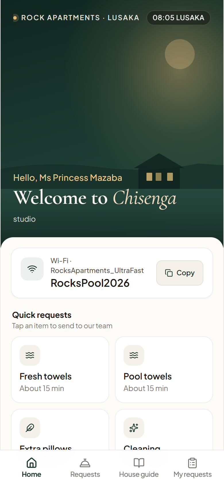
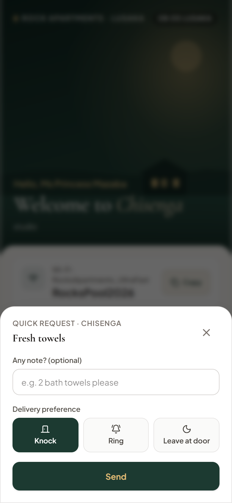
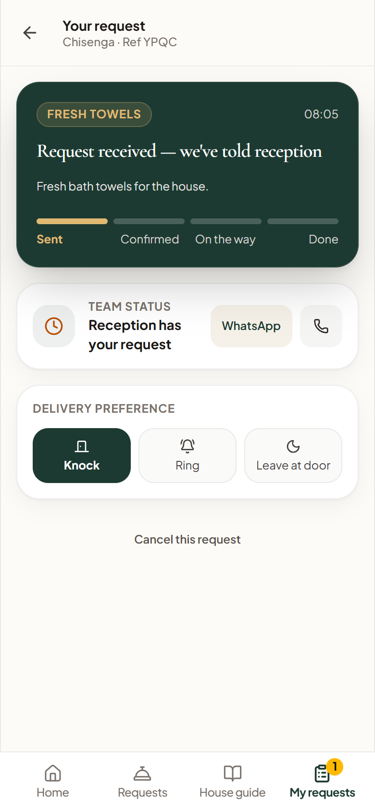
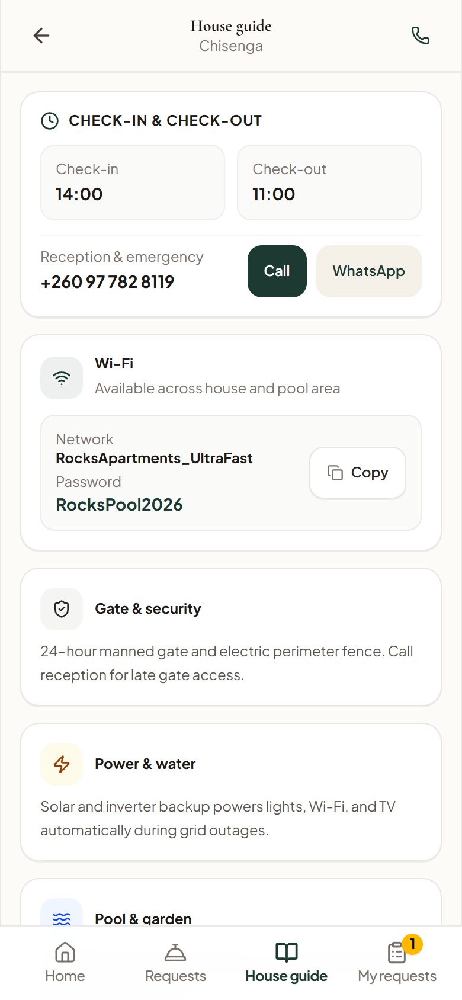
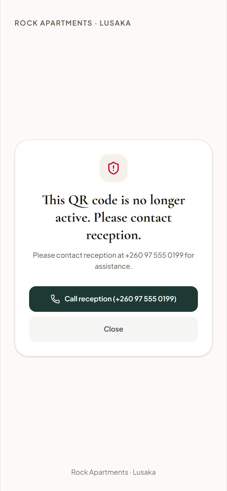
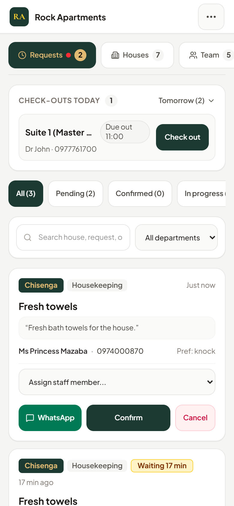
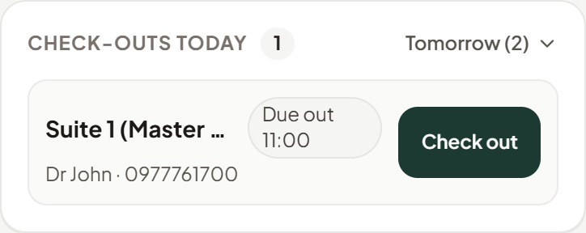
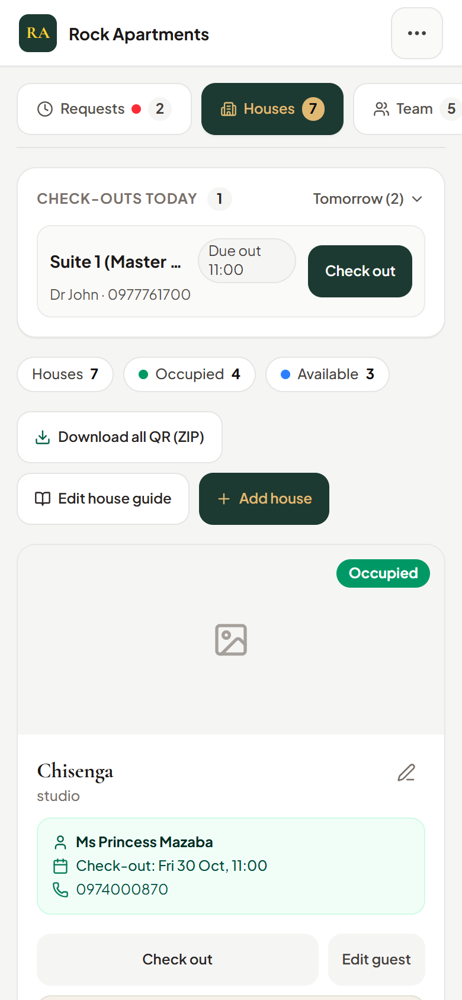
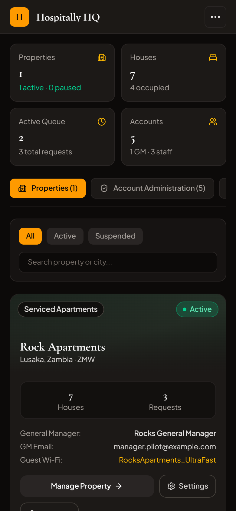
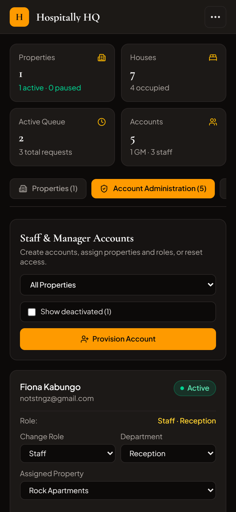

# Hospitaly Pilot Report — Rock Apartments, Lusaka

**Property**: Rock Apartments, Lusaka (`prop_rocks_lusaka`)  
**Timezone**: `Africa/Lusaka` (CAT, UTC+2)  
**Currency**: ZMW (Zambian Kwacha)  
**Status**: Ready for Pilot Deployment  

---

## 1. Summary of Changes (By Area)

### A. Mobile & Viewport Foundation
* **Fixed Viewport Letterboxing & White Bottom Gap**: Added `<meta name="viewport" content="width=device-width, initial-scale=1.0, maximum-scale=1.0, user-scalable=no, viewport-fit=cover">` in `index.html`.
* **Dark Fullscreen Fix**: Added `html, body { background-color: #0c0a09; }` and safe-area padding (`min-h-[100dvh] pt-safe pb-safe`) so mobile Safari and Chrome address bars never leave white gaps behind dark auth gates (`LoginGate.tsx`).
* **Store Optimization**: Fixed React 19 `useSyncExternalStore` getSnapshot caching in `src/lib/store.ts` to prevent infinite re-renders (`Error #185`).

### B. Guest Experience (QR-Only, No Login)
* **Dynamic House Branding**: Replaced static placeholders with dynamic `{houseName}` banner, house type ("Two-Bedroom Garden Apartment", "Garden Studio Apartment", "Executive Twin Suite"), personal guest greeting ("Hello, Ms Princess Mazaba"), and real-time Lusaka clock pill.
* **Wi-Fi Card**: Single high-contrast card showing SSID (`8119 vip` or `Bobo Vip`) and full visible password (`@rocks.8119`) with 1-tap clipboard copy and haptic feedback.
* **Clean Friendly Copy**: Removed all hotel-chain jargon ("Bedside Receptors", "Concierge dispatch") and out-of-scope errands ("Airport Transfer to KKIA"). Quick requests focus on essentials: Fresh towels, Pool towels, Extra pillows, Cleaning, Gas & kitchen help, Something broken, or Something else.
* **Calm Unoccupied & Suspended States**: When a house is unoccupied or suspended, guests see a welcoming message with 1-tap phone/WhatsApp call to reception.

### C. Front Desk Operations (Staff & GM)
* **Live Check-out Tracking Strip**: Real-time countdowns for today's check-outs (grey > 2h, amber ≤ 2h, orange ≤ 30m, red overdue) with 1-tap check-out confirmation modal.
* **Live Requests Board**: Open request tickets with live minute counters. GM/Staff can acknowledge tickets and assign team members (Founder is excluded from the assign dropdown).
* **Archive Cancelled Requests**: GM can move cancelled tickets to an archive tab with 1 tap.
* **House Photo Upload**: Client-side JPEG compression engine (< 300KB) enabling instant photo updates for houses and property banner.

### D. Founder HQ (`/hq`)
* **Executive Gateway**: Founder sign-in with 30-minute idle session timeout policy and 2-minute warning sheet.
* **Property Governance**: 1-tap property suspension with custom friendly guest notice and safe resume confirmation modal.
* **Account Provisioning**: Create and deactivate staff/manager accounts with password reset dispatch.
* **Activity Log**: Displays the last 50 operational, authentication, and security audit logs.

### E. QR Code & Printable Plaque Engine
* **Plaque Generator**: 300-DPI canvas engine generating 85 × 120 mm print-ready QR cards with centered house name and clear guest instruction: *"Scan for Wi-Fi, house guide & requests · No app needed · Works on any phone camera"*.
* **Scan Verification**: Integrated `jsQR` automated scan testing to verify that generated cards scan reliably before export.

---

## 2. Verified 390px Mobile Screenshots

| View | Preview |
|---|---|
| **01. Guest Home (Chisenga)** |  |
| **02. Request Flow** |  |
| **03. Status Timeline** |  |
| **04. House Guide** |  |
| **05. Suspended / Calm Notice** |  |
| **06. Staff Requests Board** |  |
| **07. Live Check-Out Strip** |  |
| **08. Houses Management** |  |
| **09. Printable QR Card** |  |
| **10. Founder HQ Overview** |  |
| **11. HQ Accounts Administration** |  |

---

## 3. Test Results Summary

* **Unit & Logic Tests (Vitest)**: **17 / 17 Passed**
  - Lusaka Time & Relative Formatting: 7 / 7 passed
  - Session Policy & Warning Calculations: 5 / 5 passed
  - QR Code Generation & `jsQR` Verification: 5 / 5 passed
* **Automated E2E Persona Tests (Playwright)**: **35 / 35 Passed**
  - **iPhone 13 (390×844)**: 7 / 7 passed
  - **Pixel 7 (412×915)**: 7 / 7 passed
  - **Small Android (360×740)**: 7 / 7 passed (zero horizontal scroll confirmed)
  - **iPhone SE (375×667)**: 7 / 7 passed
  - **Desktop Chrome (1280×720)**: 7 / 7 passed
* **Playwright HTML Report**: Available at `docs/go/playwright-report/index.html`.
* **CI Cleanliness Script**:
  - 0 forbidden hardcoded persona/house names in `src/`
  - 0 `deleteDoc` calls in `src/`
  - 0 automatic browser sanitizers in `src/`

---

## 4. Known Limitations

1. **Web Push Notifications**: Firebase Blaze-only push notifications via Cloud Functions and Cloud Storage remain disabled behind `PUSH_ENABLED=false` as specified for the pilot scope. The app uses in-app audio alerts and real-time Firestore listeners.
2. **Offline Data Sync**: While initial pilot data is preloaded for offline resilience, live multi-device synchronization requires an active internet connection to Cloud Firestore.

---

## 5. Needs From Founder (Checklist)

Before opening to physical guests at Rock Apartments, please review and provide:

- [ ] **Property Banner Photo**: Save the Rock Apartments Facebook cover photo to `public/images/rock-apartments-cover.jpg` (or upload via the GM Property Settings modal).
- [ ] **Confirm Reception Phone & WhatsApp**: Currently configured as `+260 97 405 6547`. Please verify if this is the active front desk SIM/WhatsApp line.
- [ ] **Verify House Wi-Fi Credentials**:
  - **Chipo**: Wi-Fi `8119 vip`, Password `@rocks.8119`
  - **Chisenga**: Wi-Fi `8119 vip`, Password `@rocks.8119`
  - **Bobo**: Wi-Fi `Bobo Vip`, Password `@rocks.8119`
- [ ] **Verify House Names & Types**: Confirm descriptions (e.g. *Garden Studio Apartment* for Chisenga, *Two-Bedroom Garden Apartment* for Chipo, *Executive Twin Suite* for Bobo).
- [ ] **Deploy Firestore Security Rules**: Run `firebase deploy --only firestore:rules` to deploy the hardened `firestore.rules`.
- [ ] **Auth Cleanup**: Delete any old test users in the Firebase Auth console (e.g., `founder.test@example.com`).
- [ ] **Product Name Constant**: Confirmed as `"Hospitaly"` (configured via single constant `APP_NAME`).
